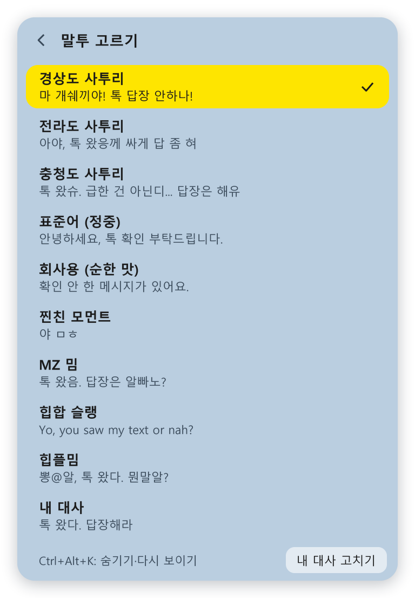

# 답장독촉방 (kakao-nagger)

카톡 답장을 미루면 화면 구석에서 잔소리해 주는 Windows 위젯입니다. 일하다 잠깐 웃으라고 만들었어요.

경상도 사투리부터 힙플밈까지 말투를 고를 수 있고, 안 읽은 1:1 채팅이 오래될수록 말풍선이 하얀색에서 노란색, 빨간색으로 바뀝니다.


> 그림 속 이름과 메시지는 모두 예시입니다.

> [!WARNING]
> 기본 말투에 욕이 나옵니다. 회사에서는 톱니바퀴 설정의 `말투`에서 **회사용 (순한 맛)** 을 고르세요. 욕이 없고 말풍선이 빨개지거나 위젯이 흔들리지도 않습니다.

## 시작하기

1. [kakao-nagger.exe 받기](https://github.com/goodafternoonoo/kakao-nagger/releases/latest/download/kakao-nagger.exe)
2. 폴더를 하나 만들어 exe를 넣고 실행합니다. 설정 파일이 exe 옆에 저장되기 때문입니다.
3. 카톡 PC의 채팅 목록 창을 열어 둡니다.

서명이 없는 프로그램이라 Windows 보안 경고가 뜰 수 있습니다. 그때는 `추가 정보` → `실행`을 누르세요. 찜찜하면 아래 [소스로 실행하기](#소스로-실행하기)를 쓰면 됩니다.

### 꼭 맞아야 하는 조건

| 조건 | 이유 |
|---|---|
| Windows 화면 배율 **100%** | 글자 위치와 모양을 100% 기준으로 읽습니다. 다른 배율이면 위젯에 안내 문구가 뜨고 읽지 않습니다. |
| 카톡 창이 **최소화·트레이 상태가 아님** | 다른 창에 가려지는 것은 괜찮지만, 최소화하면 읽을 화면이 없습니다. |
| 카톡이 **채팅 탭**에 있음 | 채팅 목록에 보이는 줄만 읽습니다. 창을 길게 두거나 `안읽음` 탭에 두면 빠짐없이 읽습니다. |

> [!NOTE]
> 아직 제작자의 PC 한 대(Windows 11, 배율 100%)에서만 확인했습니다. 다른 PC, 다크 모드, 다른 카톡 버전에서는 안 될 수 있습니다. 안 되면 [이슈](https://github.com/goodafternoonoo/kakao-nagger/issues)로 알려 주세요.

## 쓰는 법

| 하고 싶은 것 | 방법 |
|---|---|
| 답장하기 | 사람을 누르면 그 방이 열립니다. **이때 읽음 처리됩니다.** |
| 읽음 처리 없이 내용 보기 | 줄에 마우스를 올립니다. 카톡 목록에 보이는 최근 메시지만 나옵니다. |
| 그 사람만 잠깐 조용히 | 줄에 마우스를 올리고 `10분 조용히` |
| 그 사람은 앞으로 안 보기 | 줄에 마우스를 올리고 `안 보기`. 8초 안에 되돌릴 수 있습니다. |
| 전부 조용히 | 달 버튼 (30분). 동그라미에 달 표시가 붙습니다. |
| 접기 | `─` |
| 바로 숨기기 / 다시 보이기 | `Ctrl+Alt+K`. exe를 다시 실행해도 나타납니다. |
| 말투·거르기·자동 실행 | 톱니바퀴 |
| 끄기 | `X`. 접힌 동그라미에서는 마우스를 올리면 나타납니다. |

읽고 나면 잠깐 칭찬도 해 줍니다. 위젯을 끌어 옮긴 자리는 다음에 켤 때도 그대로입니다.

### 거르기

톱니바퀴 → `거르기`에서 문구를 넣으면 바로 적용됩니다. 창 아래쪽에서 지금 안 읽은 방이 보이는지, 왜 숨겨졌는지 확인할 수 있습니다.

| 규칙 | 동작 |
|---|---|
| 숨기기 · 이름 | 이름에 이 문구가 들어간 방을 숨깁니다. `쿠팡`, `토스뱅크`가 기본으로 들어 있습니다. |
| 숨기기 · 메시지 | 최근 메시지에 이 문구가 들어간 방을 숨깁니다. |
| 이것만 보기 · 이름 / 메시지 | 하나라도 넣으면 여기 맞는 방만 나옵니다. 숨기기 규칙이 먼저 적용됩니다. |

띄어쓰기와 영어 대소문자는 구분하지 않습니다. 메시지는 카톡 목록에 보이는 최근 메시지만 확인하므로, 그보다 앞의 메시지나 잘린 뒷부분, 사진·이모티콘의 내용은 거를 수 없습니다.

### 말투



**내 대사**를 고르면 직접 쓴 대사가 나옵니다. `내 대사 고치기`를 누르면 `내대사.txt`가 열리고, 저장하면 바로 반영됩니다.

## 내 카톡 내용은 어떻게 되나요?

- **인터넷으로 아무것도 보내지 않습니다.** 코드에 네트워크 기능이 없습니다.
- **메시지를 보내지 않습니다.** 자동 답장 기능이 없습니다.
- 평소에는 채팅 목록 창을 그림으로 받아 안 읽은 줄의 이름과 숫자만 읽습니다. 이 그림은 메모리에만 두고 저장하지 않습니다.
- 거르기에 메시지 문구를 넣었을 때만 안 읽은 줄의 최근 메시지를 글자로 읽습니다. 읽은 메시지도 저장하지 않습니다. 직접 넣은 규칙은 exe 옆 `settings.json`에 저장됩니다.
- 카톡에 손대는 때는 위젯에서 사람을 직접 눌렀을 때뿐입니다. 이때 위젯이 대신 그 줄을 더블클릭해 방을 엽니다.
- `--diag` 진단 모드는 창 구조와 Windows 알림 기록 속 카톡 알림 개수를 `진단결과.txt`에 씁니다. 이름은 `●`로 가려집니다.

## 알려진 한계

- 1:1 방만 봅니다. 채널도 1:1처럼 보이니 알림을 받기 싫은 채널은 `안 보기`나 거르기로 빼 주세요.
- 방을 열 때 채팅 목록 창이 같이 올라오는 일이 가끔 있습니다.
- 카톡 화면 구성이 바뀌면 못 읽을 수 있습니다.

## 소스로 실행하기

Python이 깔린 Windows에서 실행합니다. 맑은 고딕 글꼴을 씁니다.

```bash
pip install -r requirements.txt
py kakao_nag.py --demo
py kakao_nag.py
```

`--demo`는 카톡 없이 가짜 이름으로 화면만 띄웁니다. 설치까지 한 번에 하는 `1_demo.bat`, `2_diagnose.bat`, `3_run.bat`도 있습니다.

exe를 직접 만들려면:

```bash
pip install pyinstaller
pyinstaller --onefile --noconsole --name 답장독촉방 --icon assets/icon.ico kakao_nag.py
```

## 라이선스

[MIT](LICENSE). 카카오와 관계없는 비공식 개인 프로젝트이고, KakaoTalk은 Kakao Corp.의 상표입니다.
